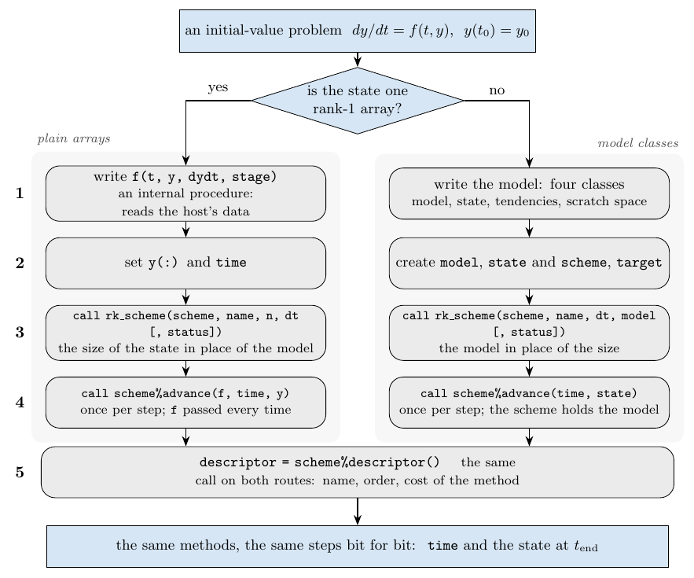
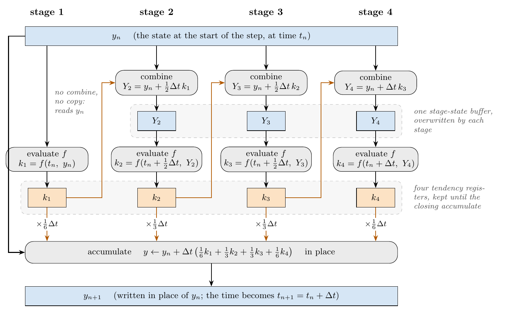
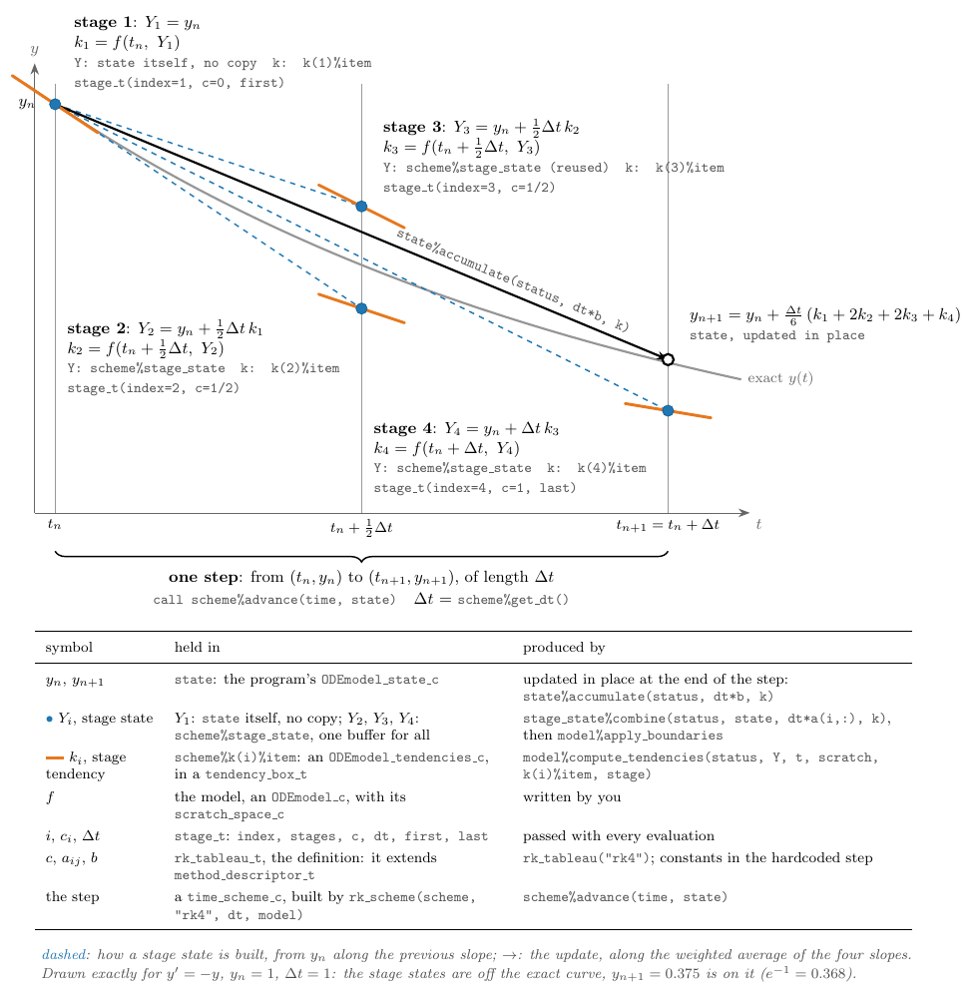

# Proposal: time integration of initial-value problems in stdlib

**Status:** draft for discussion, 2026-10-18; a first version, with what later versions would add in the scope (section 7)\
**Implementation:** `stdlib_Integrate` (this repository), working and tested (fpm, gfortran), double precision only\
**Author:** Francesco Tucciarone

## 1. Overview

This proposal adds to stdlib the time integration of an initial-value problem

$$
\frac{dy}{dt} = f(t, y), \qquad y(t_0) = y_0,
$$

with explicit Runge-Kutta methods at fixed steps: three methods (Wicker-Skamarock RK3, classic RK4, Dormand-Prince 5(4)), classic RK4 as a hardcoded step and the others on a generic engine that runs any explicit Butcher tableau, so that adding a method is adding a tableau. It separates *what* is integrated, which the program provides, from *how* it is integrated, which the library provides: the program describes $f$ and the state, the library builds a *time scheme* for a method and advances the state with it, one step at a time.

How the program describes the problem depends on the shape of its state, and that is the only decision before writing any code:



A state that is one rank-1 array needs nothing but a right-hand side `f(t, y, dydt, stage)`. Any other state (several fields, grids, halos, tiles) is described by four abstract types the program extends: a model, its state, its tendencies and a scratch space (section 5); the library then works on the program's own data and never copies or reorganises it. That second route is what existing Fortran ODE libraries do not offer, and it is what models built on the method of lines need (ocean, atmosphere and transport models, in our case). Either way the program goes through the same five steps, and the library runs the same methods, with the same steps, bit for bit. Everything is re-exported by `use stdlib_Integrate`.

Four words keep one meaning each, here and in the code:

- a **method** is the mathematical object (classic RK4, Dormand-Prince 5(4));
- a method's **descriptor** is what describes the method (name, order, error estimate, SSP coefficient, cost);
- a method's **definition** is its descriptor plus the coefficients that fully define the method (for a Runge-Kutta method, its Butcher tableau);
- a **scheme** is a method running on a model, with its buffers and time step.

## 2. A first program: plain arrays

Exponential decay, $dy/dt = -\lambda y$ for three values at once, with classic RK4 at a fixed step $\Delta t = 0.01$, to $t = 1$; the whole program (`wp` is double precision: the library is `dp`-only today, and generating it for every real kind is one of the changes section 9 proposes):

```fortran
program decay
    use stdlib_kinds,     only: wp => dp
    use stdlib_Integrate, only: rk_scheme, rk_array_scheme_t, stage_t, &
                                status_t, method_descriptor_t
    implicit none

    real(wp), parameter       :: lambda = 2.0_wp, t_end = 1.0_wp, dt = 0.01_wp
    integer,  parameter       :: n_steps = nint(t_end / dt)
    type(rk_array_scheme_t)   :: scheme
    type(status_t)            :: status
    type(method_descriptor_t) :: descriptor
    real(wp), allocatable     :: y(:)
    real(wp)                  :: time
    integer                   :: it

    y    = [1.0_wp, 2.0_wp, 3.0_wp]                  ! 2. the initial condition
    time = 0.0_wp

    call rk_scheme(scheme, "rk4", size(y), dt, status)   ! 3. the scheme
    if (status%failed) error stop status%message

    do it = 1, n_steps                               ! 4. the time loop
        call scheme%advance(f, time, y, status=status)
        if (status%failed) exit
    end do

    descriptor = scheme%descriptor()                 ! 5. what was run
    print '(a, ": error ", es9.2, ", ", i0, " evaluations")', descriptor%title, &
          maxval(abs(y - [1, 2, 3] * exp(-lambda * time))), &
          n_steps * descriptor%f_evals

contains

    subroutine f(t, y, dydt, stage)                  ! 1. the right-hand side
        real(wp),      intent(in)  :: t, y(:)
        real(wp),      intent(out) :: dydt(:)
        type(stage_t), intent(in)  :: stage
        dydt = -lambda * y                           ! lambda: from the host
    end subroutine f

end program decay
```

It prints `Classic RK4: error 1.10E-09, 400 evaluations`. The count is `n_steps * descriptor%f_evals`: 100 steps, and RK4 evaluates $f$ 4 times per step; the error, of order $\Delta t^4$, is that of a fourth-order method. The five steps, as numbered in the comments:

1. **The right-hand side** $f(t, y)$, here an internal procedure `f`, which reads `lambda` from the program by host association, with no extra argument (the closest Fortran has to a closure). `dydt` is `intent(out)`: `f` sets every value of it, at every call. The fourth argument, a `stage_t`, says which evaluation this is: the stage (`index` of `stages`), its time fraction `c` (the evaluation is at $t_n + c\,\Delta t$), the step `dt`, and whether it is the `first` or the `last` evaluation of the step. Most right-hand sides ignore it, but it is part of the one interface every `f` has, rather than optional, so that a scheme never has to ask whether `f` takes it; a right-hand side may use it to compute an expensive term once per step, or to draw a stochastic increment once per step. (Some compilers warn about an unused dummy argument; the warning is harmless here.)
2. **The initial condition**: `y` and `time`, owned by the program. The scheme keeps neither.
3. **The scheme**, built in place by `rk_scheme` (section 3.1 says why): the method by name, the size of the state, the time step. It allocates its buffers here, once, for that size: the state must keep it, and must be a contiguous array (a strided section would have to be copied in and out at every step, so it is refused). A failure, such as an unknown name, comes back in `status`: a `status_t` holds `failed` and `message`, the role stdlib's `state_type` plays, which section 9 proposes to use instead.[^errorstop]
4. **The time loop**: each `advance` moves `y` *and* `time` one step forward, both through its arguments: the program never writes `time = time + dt` itself. It evaluates $f$ once per stage. `f` is passed every time and never stored, so nothing needs to be `target`, and `f` is always called while the program that contains it is running. A failure is returned in `status`, with `time` and `y` left at the last good step; without `status`, the scheme stops the program with the failure's message.
5. **What was run**: `descriptor()` returns the method's descriptor (name, title, order, evaluations per step).

An optional `boundaries(t, y, stage)` argument of `advance` fills halos and applies boundary conditions, as a model's `apply_boundaries` does.

[^errorstop]: `error stop status%message` uses a stop code that is not a constant, which Fortran 2018 allows; a Fortran 2008 compiler needs `print *, status%message` followed by `error stop`.

**When one array is not enough.** The plain-array route stops at a single rank-1 array: no separate fields, no multi-dimensional arrays without flattening them by hand, no tiles. The model classes lift all of that: the library works on the program's own data through the procedures of its state. The same five steps follow, with step 1 becoming a model (section 5).

## 3. Time schemes on plain arrays

The scheme of section 2, an `rk_array_scheme_t`, holds the time step and the buffers its method needs (the stage values and tendency registers, arrays of the state's size), all allocated once when it is built. It holds no reference to anything: the right-hand side comes with every call. Its one operation is `advance`, which moves the state and its time forward by one step.

### 3.1 Building a scheme

A scheme is built *in place*, by a subroutine, never returned by a function: Fortran copies a function's result on assignment, and for a scheme that copy would include every buffer. By name or by tableau:

```fortran
call rk_scheme(scheme, name,    n, dt [, status])
call rk_scheme(scheme, tableau, n, dt [, status])
```

with `n` the size of the state and `dt` the time step. The methods are `rk3ws`, `rk4` and `dp54`; `rk_method_names()` lists them, so a name can come from a namelist. By name, `"rk4"` runs its hardcoded step and the other methods a loop over their tableau; given a tableau, an `rk_tableau_t`, the scheme runs the loop on it, for any explicit tableau, including one built by hand (section 5.4). `scheme%get_dt()` and `scheme%set_dt(dt)` read and change the time step.

Building fails on an unknown name, an invalid tableau or a size below 1. The failure comes back in the optional `status`, with a message, and the scheme is left not built: advancing it is itself a failure. Without `status`, the failure stops the program with its message. Building again, on the same variable, discards what was there.

### 3.2 Describing a method: the descriptor

What describes every method, whatever its family, is its descriptor, a `method_descriptor_t`; `scheme%descriptor()` returns the descriptor of the method the scheme runs:

| component | meaning |
|---|---|
| `name`, `title`, `reference` | short name (`"rk4"`), title, source of the coefficients |
| `order` | order on general (nonlinear) problems |
| `order_hat` | order of the embedded error estimate; 0 if there is none |
| `explicit` | no equation to solve for the new state (true for every method so far) |
| `ssp_coef` | SSP coefficient $C$: the step is strong-stability preserving for $\Delta t \le C\,\Delta t_{\mathrm{FE}}$, with $\Delta t_{\mathrm{FE}}$ the step at which forward Euler is; 0 if not SSP. 0 for the three methods of the library (classic RK4 too) |
| `f_evals` | evaluations of $f$ per step: the cost, comparable across methods and families |
| `ssp()` | `ssp_coef > 0` |

A method's definition is its descriptor plus its coefficients: `rk_tableau(name [, found])` returns it, an `rk_tableau_t` holding the Butcher tableau ($A$, $b$, $c$, $\hat b$) and the properties only a Runge-Kutta method has (linear order, FSAL), with the descriptor as its parent, `tab%method_descriptor_t`. `f_evals` is the method's cost per step: the stages a step evaluates (`dp54` evaluates 6 of its 7, the seventh being used only by an error estimate). The values are set with the coefficients, and the tests check the orders against them through Butcher's order conditions (section 8).

### 3.3 What a step does

`advance(f, time, y)` replaces `y` and `time` with their values one step later. For a method with stages $i = 1, \dots, s$ it builds each stage value $Y_i$ from `y` and the earlier tendencies, in one whole-array expression, evaluates $f$ on it at the stage time into a tendency register, and finishes by adding the weighted tendencies to `y`, in place. For classic RK4:

$$
\begin{aligned}
          &                                                         & k_1 &= f(t_n,\ y_n), \\
Y_2       &= y_n + \tfrac12 \Delta t\, k_1,                           & k_2 &= f\bigl(t_n + \tfrac12 \Delta t,\ Y_2\bigr), \\
Y_3       &= y_n + \tfrac12 \Delta t\, k_2,                           & k_3 &= f\bigl(t_n + \tfrac12 \Delta t,\ Y_3\bigr), \\
Y_4       &= y_n + \Delta t\, k_3,                                    & k_4 &= f\bigl(t_n + \Delta t,\ Y_4\bigr), \\
y_{n+1}   &= y_n + \Delta t\,\bigl(\tfrac16 k_1 + \tfrac13 k_2 + \tfrac13 k_3 + \tfrac16 k_4\bigr), & t_{n+1} &= t_n + \Delta t.
\end{aligned}
$$

The step the library runs for it is exactly that. Here is the routine `advance` calls for `rk4`, hardcoded (`src/schemes/rk/stdlib_integrate_rk_arrays.f90`, unedited):

```fortran
!> Classic RK4 (order 4): Kutta (1901)
subroutine step_rk4(f, boundaries, time, dt, y, k, ys)
    procedure(rk_rhs_i)                         :: f
    procedure(rk_boundaries_i),        optional :: boundaries
    real(wp),                 intent(in)        :: time, dt
    real(wp), contiguous,     intent(inout)     :: y(:)
    real(wp), contiguous,     intent(inout)     :: k(:,:), ys(:)

    type(stage_t) :: st

    st = stage_t(index=1, stages=4, c=0.0_wp, dt=dt, first=.true., last=.false.)
    if (present(boundaries)) call boundaries(time, y, st)
    ! stage 1: k1 = f(y)  ->  register 1
    call f(time, y, k(:, 1), st)
    ! stage 2: k2 = f(y + dt*(1/2*k1))  ->  register 2
    st = stage_t(index=2, stages=4, c=1.0_wp/2.0_wp, dt=dt, first=.false., last=.false.)
    ys = y + (dt*(1.0_wp/2.0_wp))*k(:, 1)
    if (present(boundaries)) call boundaries(time + (1.0_wp/2.0_wp)*dt, ys, st)
    call f(time + (1.0_wp/2.0_wp)*dt, ys, k(:, 2), st)
    ! stage 3: k3 = f(y + dt*(1/2*k2))  ->  register 3
    st = stage_t(index=3, stages=4, c=1.0_wp/2.0_wp, dt=dt, first=.false., last=.false.)
    ys = y + (dt*(1.0_wp/2.0_wp))*k(:, 2)
    if (present(boundaries)) call boundaries(time + (1.0_wp/2.0_wp)*dt, ys, st)
    call f(time + (1.0_wp/2.0_wp)*dt, ys, k(:, 3), st)
    ! stage 4: k4 = f(y + dt*(1*k3))  ->  register 4
    st = stage_t(index=4, stages=4, c=1.0_wp, dt=dt, first=.false., last=.true.)
    ys = y + (dt*(1.0_wp))*k(:, 3)
    if (present(boundaries)) call boundaries(time + dt, ys, st)
    call f(time + dt, ys, k(:, 4), st)
    ! y = y + dt*(1/6*k1 + 1/3*k2 + 1/3*k3 + 1/6*k4)
    y = y + (dt*(1.0_wp/6.0_wp))*k(:, 1) &
      & + (dt*(1.0_wp/3.0_wp))*k(:, 2) &
      & + (dt*(1.0_wp/3.0_wp))*k(:, 3) &
      & + (dt*(1.0_wp/6.0_wp))*k(:, 4)
end subroutine step_rk4
```

Each $Y_i$ is one whole-array expression into the buffer `ys`, each $k_i$ one call of `f` into a column of the registers `k`, and the last line of the formulas is the closing update of `y`, in place. Before each evaluation the routine sets the `stage_t` that `f` (and `boundaries`, if given) receives. Stage 1 evaluates $f$ on `y` directly, without a copy, and the three stage values share one buffer. If `advance` is given `boundaries`, it calls it on `y` at the start of the step and on each stage value right after it is built, before $f$ reads it.

**The tableau loop.** Every other method, and any tableau a program builds, runs one loop over its tableau. What a step needs from the tableau is computed once, when the scheme is built: which stages are used (a stage whose tendency neither $b$ nor a later row of $A$ reads, as the seventh of `dp54`, is skipped), which build a stage value (stage 1 never does: it reads `y`), and the last one evaluated. The step (`src/schemes/rk/stdlib_integrate_rk_arrays.f90`, unedited):

```fortran
!> One step of the tableau loop: the operations of time_scheme_ERK_t's
!> advance, in the same order (a stage state is `y`, then one term added
!> per nonzero coefficient; the closing update adds one term per nonzero
!> weight), on arrays.
subroutine step_loop(scheme, f, boundaries, time, y)
    type(rk_array_scheme_t),    intent(inout) :: scheme
    procedure(rk_rhs_i)                       :: f
    procedure(rk_boundaries_i), optional      :: boundaries
    real(wp),                   intent(in)    :: time
    real(wp), contiguous,       intent(inout) :: y(:)

    type(stage_t) :: st
    integer       :: i, m

    associate (tab => scheme%tableau, dt => scheme%dt, k => scheme%k, ys => scheme%ys, &
               coef => scheme%coef, last => scheme%last)
        ! The initial state: halos and boundary conditions, read by stage 1.
        st = stage_t(index=1, stages=tab%stages, c=tab%c(1), dt=dt, first=.true., last=(last == 1))
        if (present(boundaries)) call boundaries(time, y, st)

        do i = 1, tab%stages
            ! A stage nothing uses (only an embedded error estimate would): skip it.
            if (.not. scheme%used(i)) cycle
            st = stage_t(index=i, stages=tab%stages, c=tab%c(i), dt=dt, first=(i == 1), last=(i == last))
            if (scheme%combines(i)) then
                coef(1:i-1) = dt*tab%A(i, 1:i-1)
                ys = y
                do m = 1, i - 1
                    if (coef(m) /= 0.0_wp) ys = ys + coef(m)*k(:, m)
                end do
                if (present(boundaries)) call boundaries(time + tab%c(i)*dt, ys, st)
                call f(time + tab%c(i)*dt, ys, k(:, i), st)
            else
                ! Stage state = y (always for stage 1): no copy.
                call f(time + tab%c(i)*dt, y, k(:, i), st)
            end if
        end do

        ! y <- y + dt * sum_i b(i) k(i)
        coef(1:tab%stages) = dt*tab%b
        do m = 1, tab%stages
            if (coef(m) /= 0.0_wp) y = y + coef(m)*k(:, m)
        end do
    end associate
end subroutine step_loop
```

A stage value is `y` plus one term per nonzero coefficient, added one at a time, and the closing update adds one term per nonzero weight: the same operations, in the same order, as the generic engine on model classes (section 5.3), so the two routes give the same steps, bit for bit. On RK4's tableau the loop gives the same steps as the hardcoded RK4, bit for bit too. The buffers a scheme holds, besides the state the program owns:

| method | `rk3ws` | `rk4` | `dp54` |
|---|:-:|:-:|:-:|
| tendency registers | 3 | 4 | 7 |
| stage-value buffers | 1 | 1 | 1 |

The loop keeps one register per stage; the hardcoded RK4 needs all four anyway, since its closing update reads every tendency.

## 4. Behind the scenes

What the Fortran does, call by call, when the program of section 2 runs.

### 4.1 Building: `rk_scheme(scheme, "rk4", size(y), dt, status)`

`rk_scheme` is a generic interface. The plain-array form is chosen by the type of its first argument, `type(rk_array_scheme_t)`, and the name form by the type of the second, a character string. It makes every decision about the method, once (abridged):

```fortran
subroutine rka_scheme_by_name(scheme, name, n, dt, status)
    type(rk_array_scheme_t), intent(out) :: scheme       ! any previous content is discarded
    ...
    tab = rk_tableau(name, found)
    if (.not. found) then
        call local_status%raise('unknown Runge-Kutta method "' // name // '"; known: ...')
    else if (n < 1) then
        call local_status%raise("the state size must be at least 1")
    end if
    if (local_status%failed) then                        ! not built: advancing it is a failure
        call fail_step(local_status, status, "rk_scheme", "cannot build the scheme")
        return
    end if
    if (name == "rk4") then
        scheme%hardcoded_rk4 = .true.                    ! advance calls the hardcoded step
        scheme%description = tab%method_descriptor_t     ! what descriptor() will return
        allocate(scheme%k(n, 4), scheme%ys(n))           ! the registers, and the stage values
        scheme%n = n
        scheme%dt = dt
        scheme%built = .true.
    else
        call build_loop(scheme, tab, n, dt)              ! the tableau loop: section 3.3
    end if
end subroutine rka_scheme_by_name
```

After this call the scheme knows its step, its size, its time step and its descriptor, and holds every buffer it will ever use: $4n + n$ values for `rk4`. Nothing is decided or allocated again while it steps.

### 4.2 Advancing: `scheme%advance(f, time, y, status=status)`

`advance` checks its arguments, calls the step, and moves the time:

```fortran
subroutine rka_advance(scheme, f, time, y, boundaries, status)
    ...
    if (.not. scheme%built) then
        call local_status%raise("the scheme was not built (call rk_scheme first)")
    else if (size(y) /= scheme%n) then
        call local_status%raise("the state has size ...")
    else if (.not. is_contiguous(y)) then
        call local_status%raise("the state must be a contiguous array, not a strided section")
    end if
    if (local_status%failed) ...                         ! returned in status, or stops (section 4.3)
    yc => y                                              ! y, checked contiguous, as a contiguous pointer

    if (scheme%hardcoded_rk4) then
        call step_rk4(f, boundaries, time, scheme%dt, yc, scheme%k, scheme%ys)
    else
        call step_loop(scheme, f, boundaries, time, yc)
    end if
    time = time + scheme%dt
end subroutine rka_advance
```

The steps declare their `y` contiguous. `advance` hands them `yc`, a contiguous pointer to the `y` it has just checked, rather than `y` itself: handing an assumed-shape array to a contiguous dummy argument costs the compiler's argument handling at every call (measured with gfortran: about 20 ns on a 23 ns step of `rk4` at $n = 3$, and 23% at $n = 1000$), while a contiguous pointer costs nothing.

The step is the one of section 3.3: for `rk4`, four calls of `f`, three whole-array expressions into `ys`, and the update of `y` in place, with the `stage_t` of each evaluation set as constants. The checks fail before any work, so a failed call leaves `time` and `y` as they were. `f` and `boundaries` are only passed through, never stored.

### 4.3 Errors

Every check raises an error in a local `status_t`. At the end, one routine decides what to do with it: if the caller passed `status`, the failure is copied there and the call returns; if not, the program stops with `error stop` and the failure's message:

```
ERROR STOP rk_array_scheme%advance: time step failed
  the state has size 3, the scheme was built for 4
```

### 4.4 `scheme%descriptor()`

It returns a copy of the descriptor the scheme stored when it was built: the method's, from its definition, with `f_evals` counted by the tableau loop for a tableau built by hand.

### 4.5 What a step never does

A step of the plain-array route allocates nothing, copies no state (a strided `y` is refused rather than copied), and never stores `f` or `boundaries`. Per call of `advance`, besides the step itself, there are three checks of the arguments (built, size, contiguity), one test of which step to run, and the update of `time`; inside the step, one test per stage of whether `boundaries` was given.

## 5. Model classes

When the state is not one rank-1 array (several fields, multi-dimensional grids, halos, tiles), the program describes it with four abstract types it extends, from `stdlib_integrate_model`:

| type | extends | role | must implement |
|---|---|---|---|
| the model | `ODEmodel_c` | the problem: what $f$ needs and does not change in time (grid, parameters, forcing) | `allocate_state`, `allocate_tendencies`, `allocate_scratch`, `compute_tendencies` |
| its state | `ODEmodel_state_c` | the degrees of freedom $y$: the fields that evolve | `update` ($y \leftarrow y + \text{scale}\cdot k$), `copy` |
| its tendencies | `ODEmodel_tendencies_c` | the result $k = f(t, y)$ of one evaluation | nothing: plain data |
| its scratch space | `scratch_space_c` | working memory for evaluating $f$ (intermediate fields, halo copies) | nothing (the base type itself if none is needed) |

The library never sees the state's data directly: it builds stage states and updates the state through the procedures the state provides. The program goes through the five steps of section 2, and the library runs the same methods with the same steps: the program below integrates the same problem as section 2 and gives the same values, to the last bit.

### 5.1 A first program on model classes

Exponential decay again, $dy/dt = -\lambda y$ for three values, with classic RK4 at $\Delta t = 0.01$ to $t = 1$. Step 1, the right-hand side, becomes a module with the four types:

```fortran
module decay_model
    use stdlib_kinds,     only: wp => dp
    use stdlib_Integrate, only: ODEmodel_c, ODEmodel_state_c, ODEmodel_tendencies_c, &
                                scratch_space_c, status_t, stage_t
    implicit none
    private

    type, extends(ODEmodel_c), public :: decay_model_t          ! the problem: what f needs
        real(wp) :: lambda = 1.0_wp
        integer  :: n = 0                                      ! values in the state
    contains
        procedure :: allocate_state, allocate_tendencies, allocate_scratch
        procedure :: compute_tendencies
    end type

    type, extends(ODEmodel_state_c), public :: decay_state_t    ! what evolves: y
        real(wp), allocatable :: y(:)
    contains
        procedure :: update, copy
    end type

    type, extends(ODEmodel_tendencies_c) :: decay_tendencies_t  ! one evaluation: dy/dt
        real(wp), allocatable :: dydt(:)
    end type

contains

    subroutine allocate_state(model, state)                    ! the allocators: called by the
        class(decay_model_t),                 intent(in)  :: model   ! scheme, once, when it is built
        class(ODEmodel_state_c), allocatable, intent(out) :: state
        allocate(state, source=decay_state_t(y=spread(0.0_wp, 1, model%n)))
    end subroutine allocate_state

    subroutine allocate_tendencies(model, tendencies)
        class(decay_model_t),                      intent(in)  :: model
        class(ODEmodel_tendencies_c), allocatable, intent(out) :: tendencies
        allocate(tendencies, source=decay_tendencies_t(dydt=spread(0.0_wp, 1, model%n)))
    end subroutine allocate_tendencies

    subroutine allocate_scratch(model, scratch)                ! no working memory needed
        class(decay_model_t),                intent(in)  :: model
        class(scratch_space_c), allocatable, intent(out) :: scratch
        allocate(scratch_space_c :: scratch)
    end subroutine allocate_scratch

    subroutine compute_tendencies(model, status, state, time, scratch, tendencies, stage)
        class(decay_model_t),         intent(inout) :: model   ! 1. the right-hand side
        class(status_t),              intent(inout) :: status
        real(wp),                     intent(in)    :: time
        class(ODEmodel_state_c),      intent(in)    :: state
        class(scratch_space_c),       intent(inout) :: scratch
        class(ODEmodel_tendencies_c), intent(inout) :: tendencies
        type(stage_t),                intent(in)    :: stage
        select type (state)
        type is (decay_state_t)
            select type (tendencies)
            type is (decay_tendencies_t)
                tendencies%dydt = -model%lambda * state%y
            end select
        end select
    end subroutine compute_tendencies

    subroutine update(state, status, scale, tendencies)        ! y = y + scale*k
        class(decay_state_t),         intent(inout) :: state
        class(status_t),              intent(inout) :: status
        real(wp),                     intent(in)    :: scale
        class(ODEmodel_tendencies_c), intent(in)    :: tendencies
        select type (tendencies)
        type is (decay_tendencies_t)
            state%y = state%y + scale * tendencies%dydt
        end select
    end subroutine update

    subroutine copy(self, status, source)                      ! self = source
        class(decay_state_t),    intent(inout) :: self
        class(status_t),         intent(inout) :: status
        class(ODEmodel_state_c), intent(in)    :: source
        select type (source)
        type is (decay_state_t)
            self%y = source%y
        class default
            call status%raise("decay_state_t%copy: the source is not a decay_state_t")
        end select
    end subroutine copy

end module decay_model
```

The model holds what $f$ needs: $\lambda$, and the size `n` its allocators give every object. The three allocators are what lets the library hold buffers of a type it does not know: a scheme calls them when it is built, once per buffer, and each allocates its polymorphic argument with the model's concrete type, sized for the model (for a gridded model, for its grid); the argument is `intent(out)`, so it always arrives deallocated. `compute_tendencies` is $f$: it receives the state and the tendencies through the abstract types, recovers their concrete types with `select type`, and fills the tendencies. The state implements the two operations from which the library builds every combination a step needs, `update` and `copy`; `copy` is where a wrong type is caught. The tendencies are plain data, and a model whose $f$ needs no working memory allocates the base scratch type.

The program:

```fortran
program decay
    use stdlib_kinds,     only: wp => dp
    use stdlib_Integrate, only: rk_scheme, time_scheme_c, status_t, method_descriptor_t
    use decay_model,      only: decay_model_t, decay_state_t
    implicit none

    real(wp), parameter :: t_end = 1.0_wp, dt = 0.01_wp
    integer,  parameter :: n_steps = nint(t_end / dt)
    type(decay_model_t),  target              :: model
    type(decay_state_t),  target              :: state
    class(time_scheme_c), allocatable, target :: scheme
    type(status_t)                            :: status
    type(method_descriptor_t)                 :: descriptor
    real(wp)                                  :: time
    integer                                   :: it

    model%lambda = 2.0_wp                            ! 1. the model
    model%n      = 3
    state%y = [1.0_wp, 2.0_wp, 3.0_wp]               ! 2. the initial condition
    time    = 0.0_wp

    call rk_scheme(scheme, "rk4", dt, model, status) ! 3. the scheme
    if (status%failed) error stop status%message

    do it = 1, n_steps                               ! 4. the time loop
        call scheme%advance(time, state, status)
        if (status%failed) exit
    end do

    descriptor = scheme%descriptor()                 ! 5. what was run
    print '(a, ": error ", es9.2, ", ", i0, " evaluations")', descriptor%title, &
          maxval(abs(state%y - [1, 2, 3] * exp(-model%lambda * time))), &
          n_steps * descriptor%f_evals
end program decay
```

It prints `Classic RK4: error 1.10E-09, 400 evaluations`, as the program of section 2, and the final values of the two programs are equal to the last bit. The five steps, by what differs from section 2:

1. **The model** replaces `f`. It is set up (parameters, grid) before the scheme is built, since the allocators size every buffer from it.
2. **The initial condition**: `state` and `time`, owned by the program, as `y` and `time` were.
3. **The scheme**: `rk_scheme(scheme, "rk4", dt, model, status)` takes the model in place of the size, and allocates `scheme`, a `class(time_scheme_c), allocatable` variable, with its concrete type. The scheme keeps a pointer to the model: the model must be `target` and outlive the scheme, and the program may change it between steps (an ocean model reversing its forcing mid-run, say), which the scheme then sees. The state and the scheme are `target` too: the library passes them on to procedures that may keep pointers to them while they run.
4. **The time loop**: `advance(time, state, status)` takes no `f`: the scheme calls the model.
5. **What was run**: the same `descriptor()`.

A driver that does not know the state's type at compile time (one program for several models) asks the model for it, as a scheme does for its buffers: `call model%allocate_state(state)` on a `class(ODEmodel_state_c), allocatable, target` variable, then sets the initial condition through `select type`.

### 5.2 The model contract

What the four types provide, required and optional (current names; section 9 proposes the stdlib names):

```fortran
! ODEmodel_c, deferred
subroutine allocate_state(model, state)              ! class(ODEmodel_state_c), allocatable, intent(out) :: state
subroutine allocate_scratch(model, scratch)          ! class(scratch_space_c),  allocatable, intent(out) :: scratch
subroutine allocate_tendencies(model, tendencies)    ! class(ODEmodel_tendencies_c), allocatable, intent(out)
subroutine compute_tendencies(model, status, state, time, scratch, tendencies, stage)
! ODEmodel_c, optional (default: nothing)
subroutine apply_boundaries(model, status, state, time, stage)   ! state intent(inout)

! ODEmodel_state_c, deferred
subroutine update(state, status, scale, tendencies)  ! state = state + scale * tendencies
subroutine copy(self, status, source)                ! self = source (same type, or an error)
! ODEmodel_state_c, optional (defaults built from copy and update)
subroutine combine(self, status, x, c, k)            ! self = x + sum(c(m) * k(m)): a stage state
subroutine accumulate(self, status, c, k)            ! self = self + sum(c(m) * k(m)): the closing update

! ODEmodel_tendencies_c, scratch_space_c: plain data, nothing to implement
```

In `combine` and `accumulate`, `c` holds the coefficients with $\Delta t$ included (zeros are skipped), and `k` is an array of `tendency_box_t`, a wrapper, since Fortran has no arrays of polymorphic objects of different types. A state may override them, for example with one loop over its arrays for all terms instead of one `update` per term; their `self`, `x` and `k` are `target`, so that a later version can give them such a default without changing the interface.

**Evaluating $f$.** `compute_tendencies` receives `state` `intent(in)`, and must not change it: a scheme may pass the step's initial state itself (stage 1, and any stage whose stage state equals it), without a copy. `time` is the stage time $t_n + c_i \Delta t$, which a model with time-dependent forcing must use rather than a time of its own. `model` is `intent(inout)`, so that an evaluation may read external data as time advances. `stage` is the `stage_t` of section 2, step 1. On an error, the procedure calls `status%raise(message)` and returns.

**Halos and boundary conditions.** A model whose stencils read halo points, or whose state has boundary conditions, overrides `apply_boundaries`. The scheme calls it on every state just before that state is evaluated: on `state` at the start of each step, and on each stage state right after it is built, with that state's time and stage. That is where a distributed model exchanges halos, and why `compute_tendencies` always reads a complete state without copying it. Since every step starts by completing `state`, the program may change it between steps (a restart, nudging); after `advance` returns, its halos are stale until the next step, so output that reads them calls `apply_boundaries` itself.

**Errors.** Every procedure of a model, a state and a scheme takes a `status_t` (`failed`, `message`, `raise(message)`). A scheme stops a step at the first failure, leaves `time` and the state at the last good step, and returns the failure in its optional `status`; without one, it stops the program with its message, as on plain arrays (section 4.3). This is the contract of stdlib's optional `err` arguments; section 9 proposes to use `state_type` itself.

### 5.3 Time schemes on model classes

A *time scheme* (`time_scheme_c`) holds a reference to the model, the time step, and the buffers its method needs (a stage state, tendency registers, a scratch space), all allocated once, through the model's allocators, when the scheme is built. Its only operation is `advance`, which moves a state and its time forward by one step. The methods, their descriptors and their steps are those of section 3; what differs is said here.

#### Building a scheme

A scheme is built in place, as on plain arrays (section 3.1), in one of two ways:

| call | what it builds |
|---|---|
| `rk_scheme(scheme, name, ...)` | the method `name`: for `"rk4"`, its hardcoded step (`time_scheme_rk4_t`), unrolled, with the coefficients as constants; for the other methods, the generic engine on their tableau. The default choice. |
| `rk_scheme(scheme, tableau, ...)` | the generic engine `time_scheme_ERK_t`: a loop over any explicit Butcher tableau, including one built by hand (section 5.4). On RK4's tableau, the same steps as the hardcoded RK4, bit for bit. What a step needs from the tableau is computed when the scheme is built. |

The full form is `rk_scheme(scheme, name | tableau, dt, model, status)`, with `scheme` a `class(time_scheme_c), allocatable` variable and `status` optional. Besides the failures of section 3.1, building fails on an invalid tableau (no stages, coefficients missing or of the wrong size, not explicit) or on a model allocator that returns without allocating; `rk_scheme` then leaves `scheme` unallocated. `scheme%descriptor()` returns the descriptor of the method, as on plain arrays (section 3.2); the tableau engine counts in `f_evals` the stages it evaluates, also for a tableau built by hand, whose other components keep their defaults (0: unknown) unless the program sets them.

#### What a step does

`advance(time, state, status)` takes the step of section 3.3, with the model's `compute_tendencies` as $f$: it applies the boundaries of `state`, builds each stage state with one `combine` and applies its boundaries, evaluates `compute_tendencies` on it at the stage time, and finishes with one `accumulate` on `state`, in place. The routine `advance` calls for `rk4`, hardcoded (`src/schemes/rk/stdlib_integrate_rk_steps.f90`, unedited):

```fortran
!> Classic RK4 (order 4): Kutta (1901)
subroutine step_rk4(scheme, time, state, status)
    class(time_scheme_rk4_t), intent(inout), target :: scheme
    real(wp),                 intent(in)            :: time
    class(ODEmodel_state_c),  intent(inout), target :: state
    type(status_t),           intent(inout)         :: status

    type(stage_t) :: st

    associate (model => scheme%model, scratch => scheme%scratch, dt => scheme%dt, k => scheme%k)
        ! The initial state: halos and boundary conditions, read by stage 1.
        st = stage_t(index=1, stages=4, c=0.0_wp, dt=dt, first=.true., last=.false.)
        call model%apply_boundaries(status, state, time, st)
        if (status%failed) return
        ! stage 1: k1 = f(y)  ->  register 1
        call model%compute_tendencies(status, state, time, scratch, k(1)%item, st)
        if (status%failed) return
        ! stage 2: k2 = f(y + dt*(1/2*k1))  ->  register 2
        st = stage_t(index=2, stages=4, c=1.0_wp/2.0_wp, dt=dt, first=.false., last=.false.)
        call scheme%stage_state%combine(status, state, [dt*(1.0_wp/2.0_wp)], &
                                        k(1:1))
        if (status%failed) return
        call model%apply_boundaries(status, scheme%stage_state, time + (1.0_wp/2.0_wp)*dt, st)
        if (status%failed) return
        call model%compute_tendencies(status, scheme%stage_state, time + (1.0_wp/2.0_wp)*dt, scratch, &
                                      k(2)%item, st)
        if (status%failed) return
        ! stage 3: k3 = f(y + dt*(1/2*k2))  ->  register 3
        st = stage_t(index=3, stages=4, c=1.0_wp/2.0_wp, dt=dt, first=.false., last=.false.)
        call scheme%stage_state%combine(status, state, [dt*(1.0_wp/2.0_wp)], &
                                        k(2:2))
        if (status%failed) return
        call model%apply_boundaries(status, scheme%stage_state, time + (1.0_wp/2.0_wp)*dt, st)
        if (status%failed) return
        call model%compute_tendencies(status, scheme%stage_state, time + (1.0_wp/2.0_wp)*dt, scratch, &
                                      k(3)%item, st)
        if (status%failed) return
        ! stage 4: k4 = f(y + dt*(1*k3))  ->  register 4
        st = stage_t(index=4, stages=4, c=1.0_wp, dt=dt, first=.false., last=.true.)
        call scheme%stage_state%combine(status, state, [dt*(1.0_wp)], &
                                        k(3:3))
        if (status%failed) return
        call model%apply_boundaries(status, scheme%stage_state, time + dt, st)
        if (status%failed) return
        call model%compute_tendencies(status, scheme%stage_state, time + dt, scratch, &
                                      k(4)%item, st)
        if (status%failed) return
        ! y = y + dt*(1/6*k1 + 1/3*k2 + 1/3*k3 + 1/6*k4)
        call state%accumulate(status, [dt*(1.0_wp/6.0_wp), dt*(1.0_wp/3.0_wp), dt*(1.0_wp/3.0_wp), &
                                       dt*(1.0_wp/6.0_wp)], k(1:4))
    end associate
end subroutine step_rk4
```

It is the routine of section 3.3 line for line: each whole-array expression into `ys` is a `combine` into the stage state, each call of `f` a call of `compute_tendencies` into a tendency register, the closing update of `y` an `accumulate`, and `boundaries`, optional there, is `apply_boundaries`, always called (its default does nothing). Every call returns at the first failure. The figure draws the same step (it leaves out `apply_boundaries`):



and the classical picture of it, with each object tagged by the library type that holds it and the call that produces it (exactly for $y' = -y$, $y_n = 1$, $\Delta t = 1$):



The scheme holds the buffers of the table in section 3.3, as a stage state and tendency registers: four registers for the hardcoded RK4, one per stage for the generic engine. The generic engine runs the loop of section 3.3 on model states: a stage state is a `combine` of the state and the earlier tendencies, the closing update one `accumulate`, both through the defaults of section 5.2 unless the state overrides them.

### 5.4 The tableau route

The generic engine runs any explicit Butcher tableau the program gives it at run time: `rk_scheme(scheme, tableau, dt, model, status)`, with `tableau` an `rk_tableau_t`, and `rk_scheme(scheme, tableau, n, dt, status)` on plain arrays. It is also how the library runs every method but classic RK4: by name, `rk3ws` and `dp54` are the engine on their tableaus. A method is a tableau and nothing else: one from a paper is in the program in a few lines, with no rebuild of the library, and runs at once on the program's own model. SSPRK3 of Shu and Osher, which is not in the library:

```fortran
type(rk_tableau_t) :: tab

tab%stages = 3
tab%A = transpose(reshape([0.0_wp,  0.0_wp,  0.0_wp, &      ! row i is A(i, :)
                           1.0_wp,  0.0_wp,  0.0_wp, &
                           0.25_wp, 0.25_wp, 0.0_wp], [3, 3]))
tab%b = [1.0_wp/6, 1.0_wp/6, 2.0_wp/3]
tab%c = [0.0_wp, 1.0_wp, 0.5_wp]

call rk_scheme(scheme, tab, dt, model, status)
```

The time loop is that of section 5.1. On its decay problem, at $\Delta t = 0.01$ and $0.005$, the errors are $2.75 \cdot 10^{-7}$ and $3.41 \cdot 10^{-8}$: an observed order of 3.01, the method's.

Building checks only that the engine can run the tableau: at least one stage, `A`, `b` and `c` allocated with sizes that match `stages`, and `A` strictly lower triangular. A wrong coefficient is not caught: the order is whatever the coefficients give, and the descriptor keeps its defaults (`order` 0, unknown; no name) unless the program sets them; only `f_evals` is counted by the engine itself. A convergence check on a problem with a known solution, as above, is what shows the coefficients are right.

**Its cost.** Measured (Apple M4, gfortran 16.1, release build, the decay model of section 5.1, classic RK4 as a step written for it and as the engine on its tableau): the engine's step takes 13% longer at $n = 3$ (63 ns against 55 ns) and 0.7% longer at $n = 10^6$, and the two give the same values to the last bit. What a step written for one method adds is not speed but buffers: the engine keeps one tendency register per stage (seven for `dp54`), where a step planned for the method could reuse a register once its tendency is no longer needed (five would do for `dp54`). That is the reason classic RK4, the reference and the most used method, has its hardcoded step, and the reason a later version could plan a step for every method, behind the same `rk_scheme(..., name, ...)` (section 7).

**Making it a method of the library.** Once the tableau works, it becomes a constructor in `src/schemes/rk/stdlib_integrate_rk_tableaus.f90`, as `rk4_tableau` is written (exact fractions, and its descriptor: name, title, reference, order, linear order, SSP coefficient, evaluations per step), and its name in `rk_tableau` and `rk_method_names`. From then on it is `rk_scheme(scheme, "ssprk3", ...)`, on model classes and on plain arrays alike, and `fpm test` checks its order conditions, its convergence and its descriptor.

## 6. Motivation

stdlib has quadrature (`stdlib_quadrature`: `trapz`, `simps`, Gauss rules) but nothing that integrates a differential equation in time. Fortran users today write their own Runge-Kutta loop, or use one of:

- ODEPACK, RKSUITE, DOPRI5 and other Fortran 77 codes: robust, but with a state that must be one array, the right-hand side an external procedure with a fixed interface, and work arrays sized by the caller;
- rklib (Jacob Williams), modern Fortran with many Runge-Kutta methods, also on a rank-1 array;
- SUNDIALS, through its Fortran interface: comprehensive, but a C library with its own vector abstraction (`N_Vector`), build system and memory model.

A model whose state is a set of 2-D or 3-D fields, possibly distributed over processes, either flattens it into one array at every stage (copies and memory) or writes its own time stepping. The second is what most such models do, which is why time integration is reimplemented model after model.

## 7. Scope

**In this proposal** (implemented and tested): what sections 1 to 5 describe, a first version. It keeps everything that is in the signatures of the right-hand side and of the model contract (`stage`, `status`, `apply_boundaries` and `boundaries`, the `target` attributes of `combine` and `accumulate`), since a change there would break every program, and leaves for later what can be added without changing a program.

**Later versions**, each a proposal of its own:

1. **Adaptive steps**: `dp54` with its embedded error estimate, an I or PI step-size controller (Hairer, Nørsett and Wanner's), the error norm as a state procedure and, on plain arrays, a hook that makes it global for a state distributed over processes; `stage_t` would gain an `attempt` counter.
2. **Pieces**: a state that shows its arrays as flat views lets the library combine states in one pass over memory, instead of one `update` per term; `is_zero` for a field that never changes.
3. **Low storage**: Williamson's 2N form, two registers whatever the number of stages, with the method `rkls33`.
4. **Planned steps**: a step routine written for every method, with its coefficients as constants and its registers reused once dead (`dp54`: five instead of seven), checked and proved exactly equal to its tableau by a Python generator at build time.

**Designed for, not proposed yet:** multistep methods (Adams, BDF), diagonally implicit and Rosenbrock methods (through an optional `solve` procedure of the model), implicit-explicit and partitioned methods, stochastic Runge-Kutta methods, exponential integrators. Section 10 says how they fit; the point for now is that none of them requires changing the API above.

**Not in scope:** nonlinear solvers, Jacobians, differential-algebraic equations, boundary-value problems.

## 8. How the methods are made

A method is its tableau: one constructor per method in `src/schemes/rk/stdlib_integrate_rk_tableaus.f90`, with the coefficients as exact fractions, and a lookup by name (section 5.4). The tests check every tableau against Butcher's order conditions, one per rooted tree up to order 5: satisfied up to the declared order, and not all satisfied at the next one, also for the embedded weights. Planned steps (section 7, item 4) would go further: a generator that recomputes every declared property exactly from the coefficients (orders, FSAL, SSP coefficient), plans each step, and proves it equal to its tableau, exactly, on symbolic forms. 31 of rklib's 76 methods have exact coefficients and can be added as they are.

## 9. Changes needed for stdlib

The library was written to stdlib's style guide (lowercase keywords, `intent` everywhere, named `end` statements, one program unit per file, submodules in `*_implementation.f90`), but not yet to its conventions for public names, kinds and errors. Proposed changes, for discussion:

| topic | now | proposed for stdlib |
|---|---|---|
| module names | `stdlib_Integrate`, `stdlib_integrate_*` | `stdlib_ode`, `stdlib_ode_*`: in stdlib "integrate" suggests quadrature |
| type names | `_t` and `_c` suffixes (`stage_t`, `ODEmodel_c`, `method_descriptor_t`) | stdlib's `_type` suffix (`ode_stage_type`, `ode_model_type`, `ode_method_descriptor_type`, ...) |
| real kinds | double precision only | `sp` and `dp`, generated by fypp, with kind-suffixed types (`ode_model_dp_type`) as `stdlib_linop_dp_type` does |
| errors | `status_t` | `state_type` from `stdlib_error`, as an optional `err` argument |
| reporting | a failure without `status` stops with its message | the same, or a report through `stdlib_logger` first |
| build | fpm only | fpm and CMake |
| tests | one program per file, own `expect` helper | stdlib's test framework |
| docs | user guide in LaTeX | a specification page, `doc/specs/stdlib_ode.md` |
| status | | experimental |

The kind question matters most. The model types are abstract classes; a kind-generic version means one hierarchy per kind (`ode_model_sp_type`, `ode_model_dp_type`), which is what stdlib's iterative solvers already do for their operator type. Extended and quadruple precision could follow if there is demand.

## 10. Other families: how they fit

The design separates what every family shares from what one family needs:

- **shared**: the model contract, `stage_t`, the method description (`method_descriptor_t`), the abstract scheme, and, with adaptive steps, the step-size controller;
- **per family**: its definitions (for Runge-Kutta methods, tableaus), the definition type extending `method_descriptor_t`, and the engines that run them.

New families add **optional** model procedures, never new class hierarchies: `solve` (find `Y` with `Y - gamma*dt*f(Y) = r`, in whatever way the model can: a tridiagonal sweep, a multigrid) for diagonally implicit, Rosenbrock and BDF methods; a second right-hand side for implicit-explicit methods; a noise term for stochastic ones. A scheme checks, when it is built, that the model provides what its method needs. Multistep methods need an engine of their own (a history of tendencies, a start-up by a Runge-Kutta method), but explicit Adams methods need nothing new from the model.

## 11. Open questions

1. **Names**: `stdlib_ode` or `stdlib_ivp`? And for the two levels, `ode_scheme_type` (classes) and `ode_array_scheme_type` (arrays)?
2. **Kinds**: `sp` and `dp` first, as the iterative solvers?
3. **Planned steps**: a later version that writes a step for every method would bring a Python generator. Is a build-time Python dependency acceptable (fypp is already one), or should the generated Fortran be committed and checked in CI against the generator?
4. **The array route** is a second implementation (the hardcoded RK4 and the tableau loop, on arrays), kept bit for bit equal to the class route by tests. A thin adapter over the class engine would remove it, at the cost of a polymorphic call per stage. Is the duplication acceptable?
5. **Procedure arguments versus pointers**: the array route passes `f` to every `advance`, so that `f` can be an internal procedure; stdlib's iterative solvers store procedure pointers in a type (`linop%matvec`). Which should stdlib prefer?
6. **The later versions**: in which order (section 7: adaptive steps, pieces, low storage, planned steps)?

## 12. Validation

- 9 test programs: every method's order conditions; every method by name against the generic engine, and the hardcoded RK4 against the engine on its tableau, bit for bit; the two routes bit for bit, by name and by tableau; convergence on both routes; every failure path; the stage information every engine passes; the boundary hook on every engine; the default `combine` and `accumulate`.
- 14 examples checking the methods against theory: convergence orders, stability limits, invariants (Kepler, Lotka-Volterra, Pleiades, Arenstorf), stiff problems at the explicit stability limit (Robertson, Van der Pol), the heat and Burgers equations.

References: J. C. Butcher, *Numerical Methods for Ordinary Differential Equations*, 3rd ed., Wiley, 2016; E. Hairer, S. P. Nørsett, G. Wanner, *Solving Ordinary Differential Equations I*, Springer, 1993; D. F. Griffiths, D. J. Higham, *Numerical Methods for Ordinary Differential Equations*, Springer, 2010.
